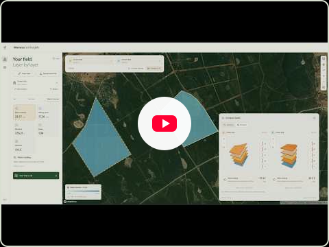
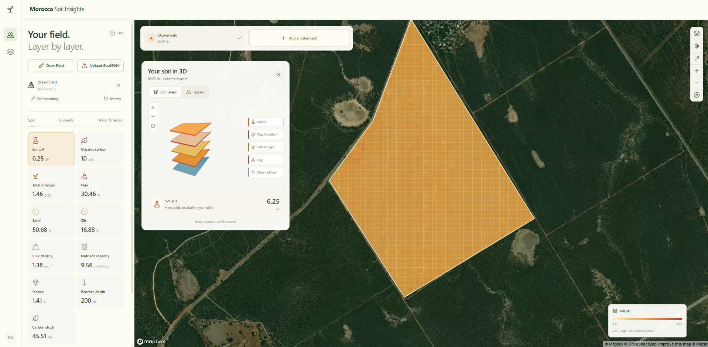
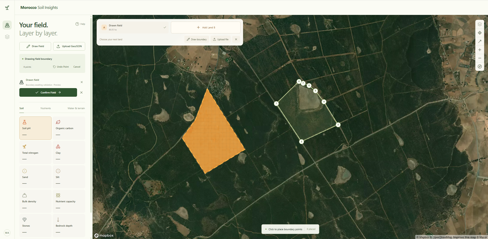
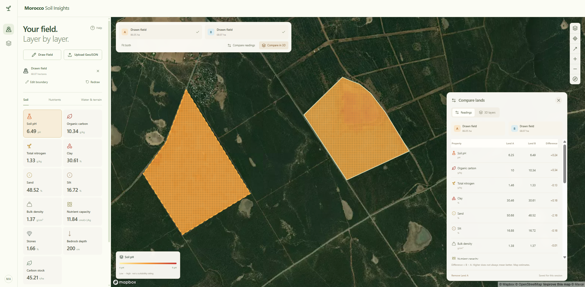
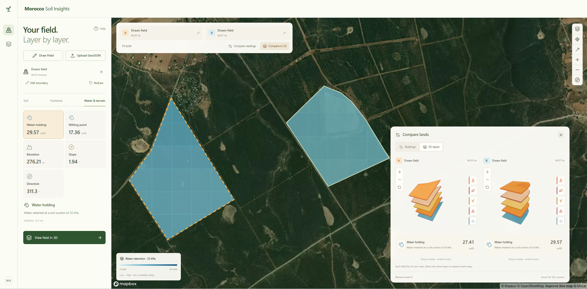

# Morocco Soil Insights

[](https://www.youtube.com/watch?v=FB_0ssN-jhc)

[*Watch the demo on YouTube*](https://www.youtube.com/watch?v=FB_0ssN-jhc)

Morocco Soil Insights lets you explore predicted soil properties for a selected field. Draw a boundary or upload a GeoJSON, confirm it, and view soil layers, terrain, and a comparison with a second field.

## Screenshots

These screenshots show the main field analysis and comparison views.

### Soil layers and 3D view



### Draw a field boundary



### Compare soil readings



### Compare fields in 3D



## What it uses

### Application stack

- **Frontend:** Next.js App Router, React, TypeScript, Tailwind CSS, Redux Toolkit
- **Maps and 3D:** Mapbox GL JS and Mapbox Satellite; Three.js for the optional 3D soil view
- **Backend:** FastAPI (Python)
- **Geospatial processing:** Rasterio, NumPy, Shapely, and PyProj
- **Requests and caching:** HTTPX and a local file cache

### External data and APIs

| Source | Role in this app | API and data links |
|---|---|---|
| **iSDAsoil** | Primary soil properties and nutrient predictions, usually at 0–20 cm and 20–50 cm | The app reads public [AWS-hosted COG rasters and metadata](https://www.isda-africa.com/isdasoil/isdasoil-on-aws/), for example [pH metadata](https://isdasoil.s3.amazonaws.com/soil_data/ph/ph.json). It does **not** call iSDAsoil’s separate [authenticated point API](https://www.isda-africa.com/isdasoil/developer/). |
| **SoilGrids (ISRIC)** | Additional properties and comparison values at native depths; used as fallback only when the property and method are compatible | Public [VRT raster files](https://files.isric.org/soilgrids/latest/data/) and the [WCS service](https://maps.isric.org/mapserv) for water-retention TIFFs. See ISRIC’s [VRT access guide](https://docs.isric.org/globaldata/soilgrids/WebDav.html) and [WCS API guide](https://docs.isric.org/globaldata/soilgrids/wcs.html). |
| **Copernicus DEM GLO-30** | Elevation, slope, aspect, and the terrain preview | Public [GLO-30 COG tiles on AWS](https://copernicus-dem-30m.s3.amazonaws.com/) and the [dataset documentation](https://registry.opendata.aws/copernicus-dem/). |
| **Mapbox** | Satellite basemap and map controls | [Mapbox GL JS](https://docs.mapbox.com/mapbox-gl-js/overview/) with a [public access token](https://docs.mapbox.com/help/getting-started/access-tokens/). |
| **Fertimap (optional)** | Point-based comparisons for selected soil and fertility fields | Disabled by default. The adapter uses a [legacy endpoint](http://www.fertimap.ma/php/detail.inc.php); public API documentation and reuse terms have not been confirmed. Do not enable it until those terms are checked. |

The app’s own backend API is documented at `http://127.0.0.1:8010/docs` when running locally. It provides `GET /api/health` and `/api/soil/catalog`, `POST /api/fields/validate`, `/api/soil/analyze`, `/api/terrain/analyze`, and `GET /api/layers/{id}`. The Next.js server proxies browser requests to FastAPI through same-origin `/api/...` routes.

Soil values are map predictions, not lab measurements. Sources use different resolutions, depths, and measurement methods; the app keeps these distinctions visible and does not treat missing data as zero.

## V2 roadmap

Planned ideas for a future version:

- **Arabic and French:** translate the field workflow, property names, units, and help.
- **Field reports:** export a PDF summary and the validated GeoJSON, including data sources, depths, and limitations.
- **Clearer comparisons:** explain source and depth matching, show data coverage, and make unavailable values clear.
- **AI soil assistant:** answer a wide range of user questions using the selected field’s available measurements and a reviewed knowledge base of trusted soil and agricultural references. Retrieval-augmented generation (RAG) can ground answers in those references, while MCP can let an AI assistant call approved tools to retrieve field results or compare land. Answers should link to sources and distinguish measured facts from estimates.
- **Model-based probabilities:** investigate ready-to-use, validated models for specific questions (for example, crop suitability). Show a probability only when the model is appropriate for Morocco and its input data; explain its sources and uncertainty. This would be a model estimate, not a guarantee.
- **Morocco-specific crop guidance:** add when reliable local crop requirements and suitable climate data are available, with sources and clear limits.

These are future ideas; they are not features currently in the app.

## Run locally

Requires **Python 3.11+** and **Node.js 22+**. From the project folder, create a Python environment:

```sh
python -m venv backend/.venv
```

Activate it in your terminal, using the command for your shell:

```sh
# macOS / Linux (bash or zsh)
source backend/.venv/bin/activate
```

```powershell
# Windows (PowerShell)
.\backend\.venv\Scripts\Activate.ps1
```

Then install the dependencies:

```sh
python -m pip install -r backend/requirements.txt
npm --prefix frontend ci
```

Add your Mapbox public token to `frontend/.env.local`:

```dotenv
NEXT_PUBLIC_MAPBOX_TOKEN=your_public_token
BACKEND_URL=http://127.0.0.1:8010
```

Keep the token public and restricted. Restart Next.js after changing `.env.local`.

Open two terminals in the project folder. Activate the Python environment in the first, then start FastAPI:

```sh
python -m uvicorn backend.main:app --host 127.0.0.1 --port 8010
```

In the second terminal, start Next.js:

```sh
cd frontend
npm run dev -- --port 3000
```

Open [http://127.0.0.1:3000](http://127.0.0.1:3000). FastAPI’s interactive API documentation is at [http://127.0.0.1:8010/docs](http://127.0.0.1:8010/docs). Keep both terminals running while using the app.

## Field files

Upload one GeoJSON `Polygon` or `MultiPolygon`, a `Feature` containing one, or a `FeatureCollection` with exactly one polygon feature. Files are limited to 5 MB. The app checks coordinates and geometry, then waits for **Confirm Field** before requesting soil data.

## Checks and project details

Run backend tests from the project folder with the Python environment activated:

```sh
python -m pytest backend/tests -q
```

Run frontend checks from `frontend`:

```sh
npm run typecheck
npm run build
```

For source limitations, attribution, and implementation details, see [ARCHITECTURE.md](ARCHITECTURE.md) and [THIRD_PARTY_NOTICES.md](THIRD_PARTY_NOTICES.md). A [project demo](docs/demo/morocco-soil-insights-demo.mp4) is also available.
